# Expense Tracker

An offline expense, income and savings tracker built with Flutter. Everything stays on the device, with no account, no server and no tracking.

[](https://github.com/64bitMagician/ExpenseTrackerApplication/actions/workflows/deploy-web.yml)

**[▶ Try the live web demo](https://64bitmagician.github.io/ExpenseTrackerApplication/)**

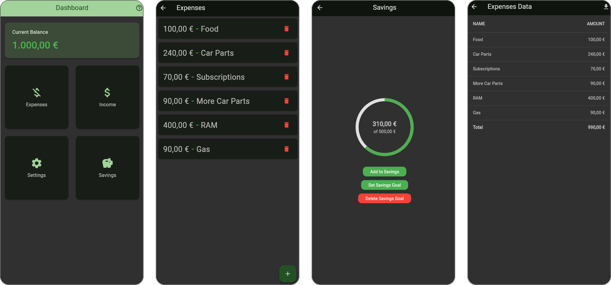

## Features

- **Live balance.** The dashboard shows your current balance, calculated from incomes − expenses − savings. It turns red when you are in the negative.
- **Expenses and incomes.** Add entries with a name and amount, and delete them with a confirmation. Amounts accept both `12.50` and `12,50`, and invalid input is rejected inline.
- **Savings goal.** Set a goal and move money into it from your balance, then track progress on a ring. A confetti animation plays when the goal is reached. Deleting the goal returns the saved money to your balance.
- **CSV export.** View all expenses or incomes as a table with a total, and export them as a CSV file. The web app downloads the file; on mobile the share sheet opens.
- **Password lock.** A password protects the app on start-up. You can change it, and recover it with a security question.
- **Help and FAQ** screen inside the app.
- **Light and dark themes** (Material 3) that follow the system setting.

## Screenshots

| Dashboard | Expenses | Income | Savings |
|:---:|:---:|:---:|:---:|
| 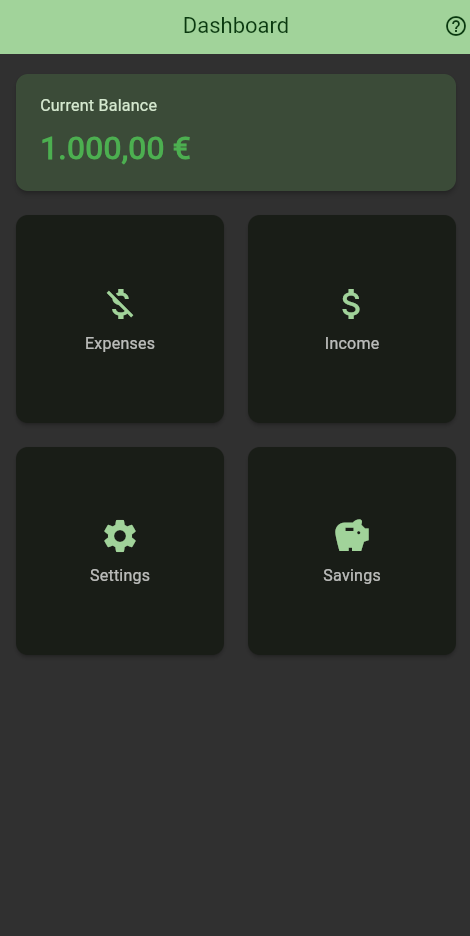 | 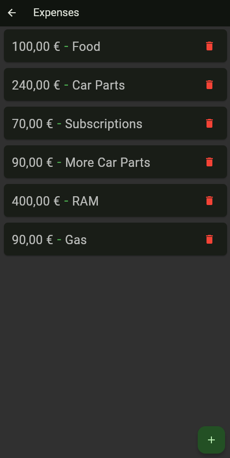 | 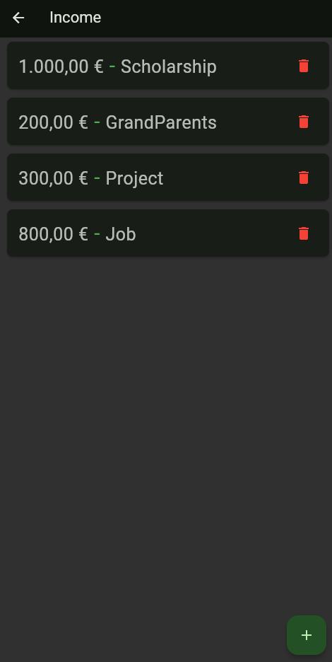 | 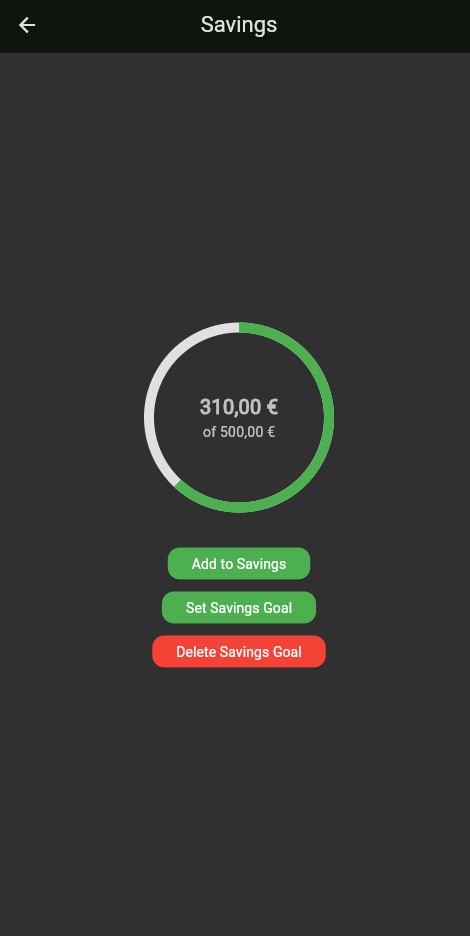 |

| Settings | Expenses data + export | Incomes data + export | Login |
|:---:|:---:|:---:|:---:|
| 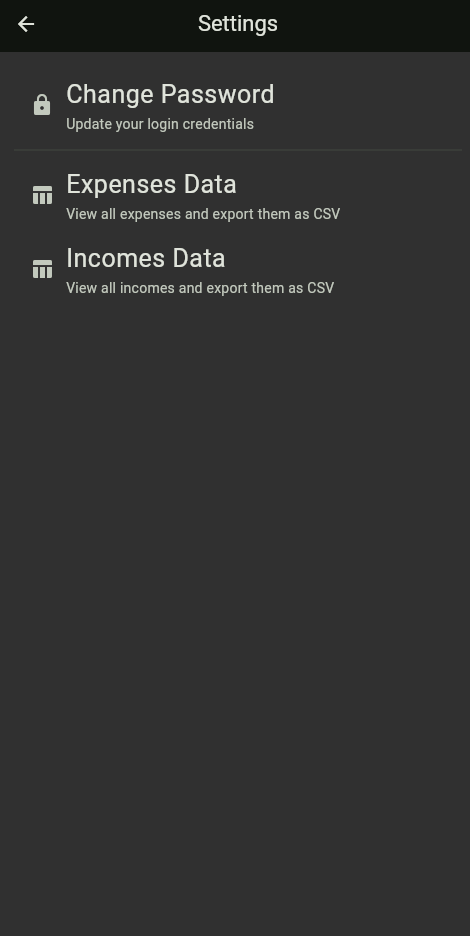 | 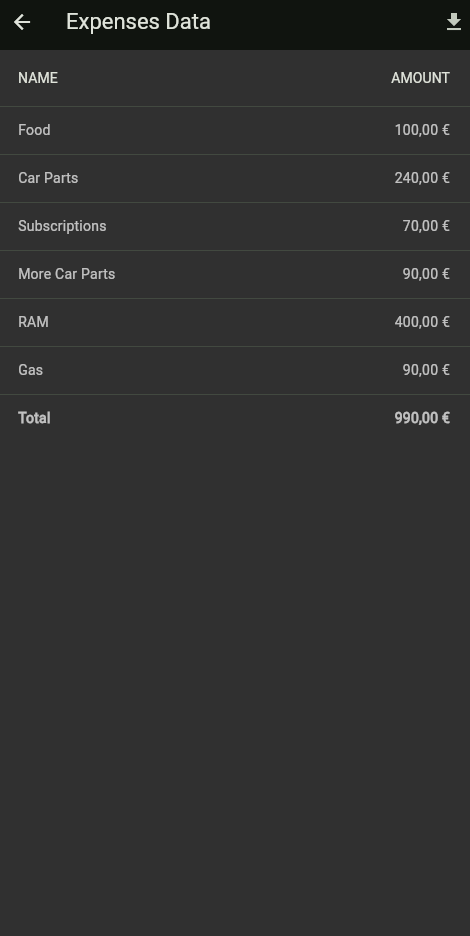 | 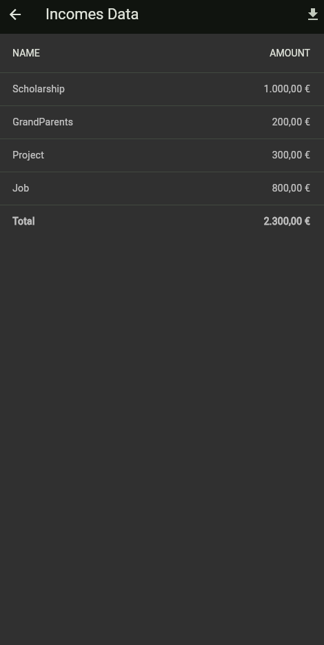 | 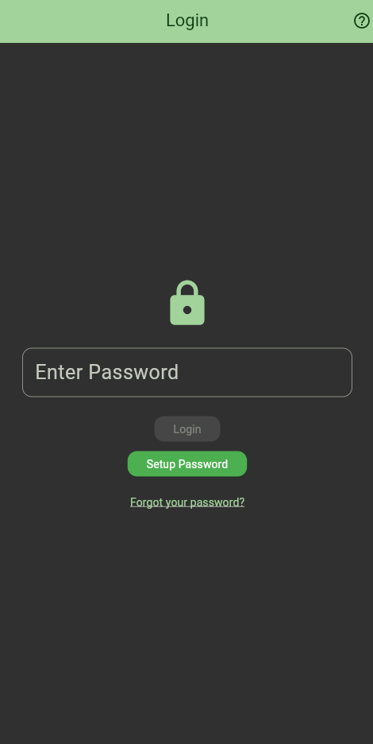 |

<details>
<summary>First launch and password recovery</summary>

| Security question (first launch) | Forgot password |
|:---:|:---:|
| 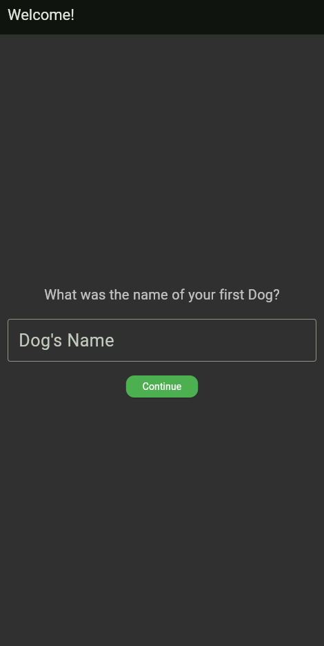 | 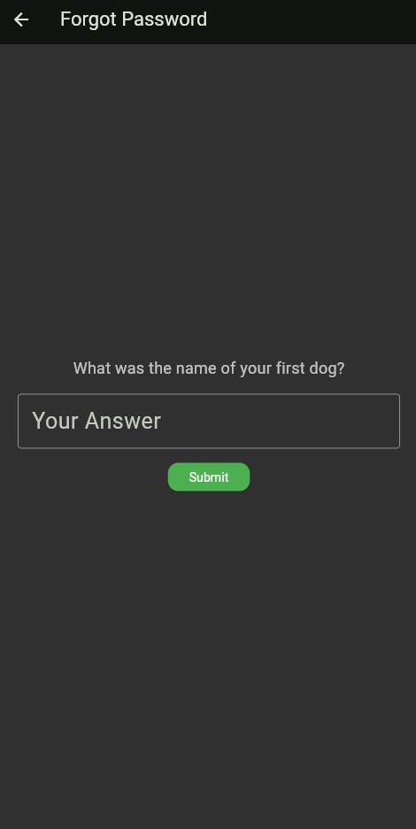 |

</details>

## Tech stack

| | |
|---|---|
| Framework | Flutter (Dart 3, Material 3) |
| Storage | [`shared_preferences`](https://pub.dev/packages/shared_preferences): device storage on mobile and desktop, `localStorage` in the browser |
| Data format | CSV via [`csv`](https://pub.dev/packages/csv) |
| Formatting | [`intl`](https://pub.dev/packages/intl) (`1.234,50 €`) |
| Export | [`share_plus`](https://pub.dev/packages/share_plus) on mobile and desktop, [`package:web`](https://pub.dev/packages/web) Blob download on web |
| Other | [`confetti`](https://pub.dev/packages/confetti) |
| CI/CD | GitHub Actions: analyze → test → build → deploy to GitHub Pages |

## Implementation notes

- **The balance is derived, not stored.** It is recalculated from the records every time, so it cannot drift out of sync with them. Sums are done in whole cents to avoid floating-point errors such as `0.1 + 0.2 ≠ 0.3`.
- **One storage layer for every platform.** Expenses and incomes are kept as CSV text in SharedPreferences, so the same code runs on Android and in the browser. Older versions stored real `.csv` files; these are migrated automatically on the first start after the update.
- **Platform-specific export through conditional imports.** `file_export.dart` picks a browser download or the native share sheet at compile time, so the UI code doesn't need to check which platform it runs on.
- **Tested logic.** Unit and widget tests cover money parsing and formatting, balance calculation, password rules, storage and migration, the entry dialog, and the CSV export.

## Getting started

Requires the [Flutter SDK](https://docs.flutter.dev/get-started/install) (3.29 or newer, Dart ≥ 3.7).

```bash
git clone https://github.com/64bitMagician/ExpenseTrackerApplication.git
cd ExpenseTrackerApplication
flutter pub get

flutter run -d chrome     # web
flutter run               # connected Android device or emulator
flutter test              # run the test suite
```

On first launch the app asks for a security question answer and then for a password. The password needs at least 10 characters, including a letter, a number and a special character.

## Project structure

```
lib/
├── main.dart                 # app entry, theme, routes, legacy data migration
├── app_routes.dart
├── screens/                  # dashboard, expenses, income, savings, settings, login, help, ...
├── data_screens/             # table view + CSV export
├── custom_widgets/           # dashboard cards, savings ring, FAQ cards, ...
├── theme/                    # light and dark Material 3 themes
└── utils/                    # storage, money, balance, dialogs, validation, export
test/                         # unit and widget tests
.github/workflows/            # web build and GitHub Pages deployment
```

## Known limitations

- **The password is a privacy lock, not encryption.** It is stored in plain text on the device, and the security question reveals it. Anyone with access to the device storage can read the data.
- **No categories, dates or charts yet.** Entries are just a name and an amount.
- **The web demo stores data only in your browser.** Clearing site data or using a private window starts fresh.

## Roadmap

- Dates and categories for entries, with monthly charts
- Hash the password and encrypt the stored data
- Import from CSV
- Multiple currencies

## License

Released under the [MIT License](LICENSE).
